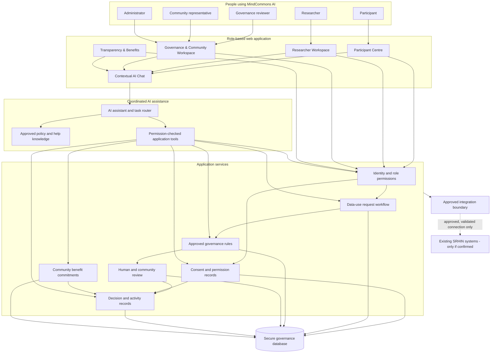

# System Architecture

## 1. Architecture overview

MindCommons AI is proposed as a web application with role-based dashboards, a shared application layer, a coordinated AI assistant and secure governance records.

The architecture is intentionally simple. The AI assistant supports the workflows; the application and its approved rules control access and record decisions.

## 2. Main architecture diagram



## 3. How the parts work

### User interface

Each person sees the workspace relevant to their role. The same application can present different tasks and records without giving every user the same access.

### Application services

These services handle the actual work:
- Store consent and permission records.
- Receive and track research requests.
- Apply approved, structured governance rules.
- Route requests for human or community review.
- Record decisions and changes.
- Track benefit commitments.

### AI assistance layer

One coordinated AI service supports different tasks based on the user's role. It retrieves approved guidance and authorised records, then prepares explanations, summaries and suggestions.

The AI does not directly connect to the database with unrestricted privileges. Any action it proposes must go through the same permission checks and application rules as a normal user action.

### Secure records

The platform stores only the information needed for governance workflows. It should not become a duplicate repository of all mental-health records.

### Integration boundary

The application may eventually exchange limited information with existing SRHIN systems. This depends on confirmed needs, technical interfaces, data-sharing agreements and approval from the relevant system owners. No integration is assumed to exist today.

## 4. AI responsibilities and limits

| AI task | AI role | Control |
|---|---|---|
| Explain consent | Explain approved wording in accessible language | Participant chooses; approved wording remains available |
| Guide researcher | Help complete a request | Researcher reviews and submits |
| Assess request | Compare request fields with approved rules and flag issues | Rules engine enforces checks; humans decide exceptions and sensitive cases |
| Summarise records | Explain status and activity | Role permissions filter records before retrieval |
| Report benefits | Summarise commitments and progress | Community representatives define and review commitments |

## 5. Example workflow

```mermaid
sequenceDiagram
    participant Participant
    participant App as MindCommons AI
    participant Assistant as AI Assistant
    participant Researcher
    participant Reviewer as Human/Community Reviewer
    participant Log as Governance Records

    Participant->>App: Review data-use explanation
    Participant->>App: Choose specific permission
    App->>Log: Record permission and version

    Researcher->>App: Submit data-use request
    App->>App: Check required fields and access rules
    App->>Assistant: Prepare request summary and flag issues
    Assistant-->>App: Summary and review flags
    App->>Reviewer: Route request and evidence
    Reviewer->>App: Record decision and reasons
    App->>Log: Record decision and audit event
    App-->>Researcher: Notify request status
    App-->>Participant: Show permitted status information
```

## 6. Important safeguards

- Role permissions are checked by the application, not decided by the AI model.
- Consent records and community rules are separate and both must be considered.
- AI summaries are labelled as AI-generated and can be corrected.
- Sensitive decisions require authorised human review.
- Public reports contain aggregated or otherwise approved information, never identifiable participant details.
- AI requests and outputs should be logged appropriately without unnecessarily copying sensitive conversation content.
- The platform must provide a route to complete essential tasks without using the chatbot.
- Data retention, deletion, withdrawal and access policies require legal, ethical and community review.

## 7. Architecture boundaries

This diagram is a proposed logical architecture. It does not specify final technologies, hosting, database products, AI providers, APIs or security certifications. Those choices should follow the host's actual needs and technical environment.

The architecture is not a claim that MindCommons AI is integrated with SRHIN or that SRHIN has approved this design.
