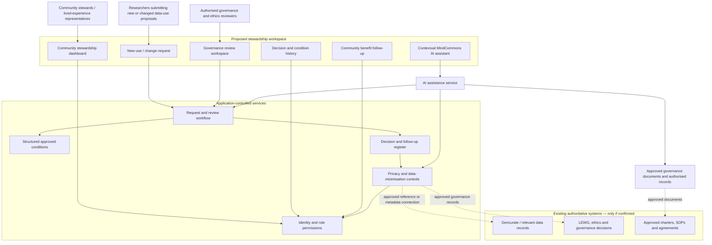
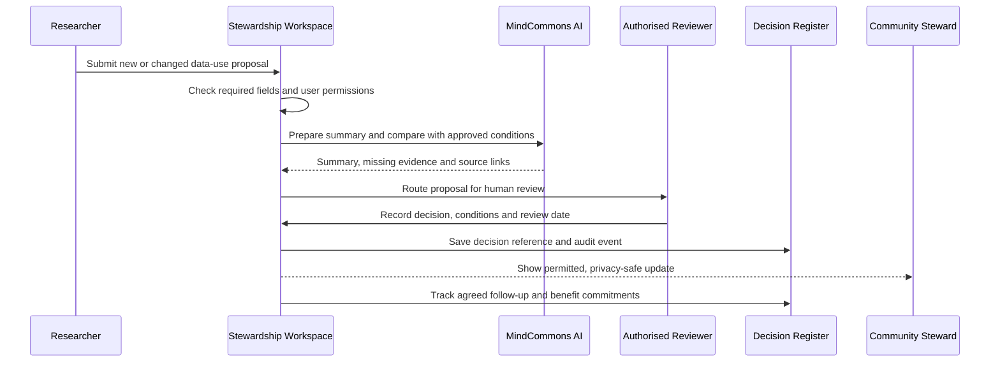

# System Architecture — Proposed Stewardship Layer

## 1. Architecture purpose

This is a logical architecture for a possible community-facing data-use stewardship interface. It is deliberately narrower than the original platform concept because SRHIN already publicly describes Gencurate, LEWG, governance charters, ethics oversight, SOPs and reporting.

The design assumes existing SRHIN systems remain authoritative. The proposed interface would only connect to them if a specific gap is confirmed and the owners approve a safe integration.

## 2. Logical architecture

## 3. What each part does

- **Dashboard:** shows proposals, reviews, conditions and follow-up relevant to the signed-in person's role.
- **Request workflow:** records new or changed data-use proposals in a structured format.
- **Approved conditions:** contains only rules and conditions that authorised governance bodies have approved.
- **Decision register:** records the decision, authority, rationale, conditions and review date, or links to the authoritative source record.
- **Benefit follow-up:** records community-defined commitments and progress; it does not decide what is fair.
- **AI assistant:** explains approved information, helps prepare requests, identifies missing evidence and drafts summaries.
- **Existing systems:** remain the source of truth. The proposed interface should reference records rather than copy sensitive data wherever possible.

## 4. AI and permission boundaries

The AI assistant must not have unrestricted database access. The application first checks the user's role and record permissions, then supplies only the information that user is authorised to see.

AI can:
- Explain a governance condition and cite its source record.
- Help prepare a change-of-use request.
- Identify missing fields or documents.
- Compare a proposal with structured, approved conditions.
- Prepare a summary for authorised reviewers.
- Summarise follow-up actions and community benefit commitments.

AI cannot approve a request, grant access, change consent, create governance policy, override LEWG or ethics decisions, or decide benefit fairness.

## 5. Example workflow

## 6. Design safeguards

- Existing SRHIN systems and governance bodies remain authoritative.
- Do not duplicate participant-level data unless strictly necessary and approved.
- Role and record permissions are enforced by the application, not by AI.
- AI summaries are labelled and linked to source records.
- Ambiguous or conflicting conditions are escalated to humans.
- Community benefit arrangements are defined by community and host authorities.
- Public or community-wide views contain only approved, privacy-preserving information.
- Every essential task has a non-chat route.

## 7. What is not specified

This diagram does not select a technology stack, database, hosting provider, AI model, API or security certification. Those decisions require confirmed requirements and SRHIN's technical review.

This is a proposed logical design, not an existing integration or a claim that the product is approved. No prototype is being built at this stage.
