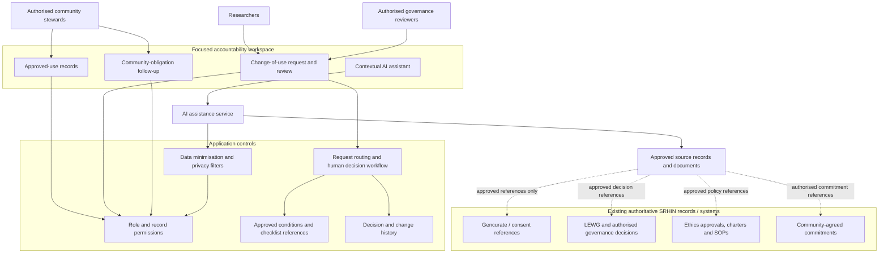
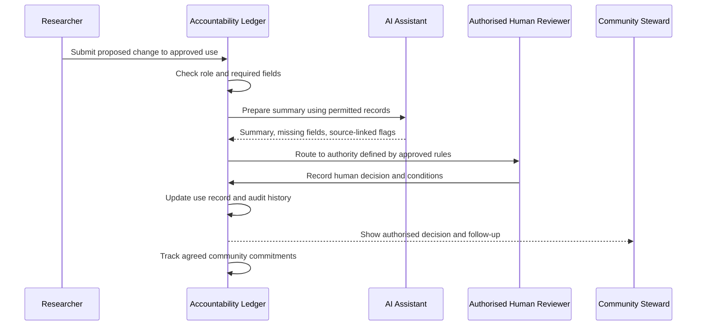

# System Architecture — Community Data-Use Accountability Ledger

**Status:** Proposed logical architecture only. No stack, integration or deployment selected.

## 1. Architectural principle

A thin accountability layer that references existing authoritative records. It should not replace Gencurate, consent systems, LEWG, ethics oversight, governance charters or existing reporting.

## 2. Three capabilities

1. Approved-use record.
2. Change-of-use review.
3. Community-obligation follow-up.

## 3. Logical architecture

## 4. Data minimisation

The ledger should hold only the minimum metadata needed to connect an approved use, its conditions, a change request and agreed commitments. It should not store raw voice recordings, transcripts, diagnoses, participant identities or copies of sensitive datasets. The source system remains authoritative.

## 5. AI boundary

The application checks permissions first. AI receives only the permitted records needed for the current task.

AI may explain source material, help complete a request, flag missing fields, compare a proposal with structured approved conditions and prepare summaries. It may not approve, deny, grant access, modify consent, create policy or determine benefit fairness.

## 6. Example sequence

## 7. Integration assumptions

No API, database, SSO, Gencurate connection or data export is assumed. A manual source reference may be safer and sufficient. Integration is considered only after SRHIN confirms need, permission, technical feasibility, ownership and security requirements.

## 8. Non-functional requirements to validate

Role-based access, audit logging, encryption, retention and deletion rules, low-bandwidth access, accessible plain-language content, backup/recovery, data residency and applicable legal/ethics requirements must be defined with SRHIN specialists. This document does not claim compliance or certification.

## 9. Status

This is a logical design hypothesis, not an implementation. No prototype is being built at this stage.
